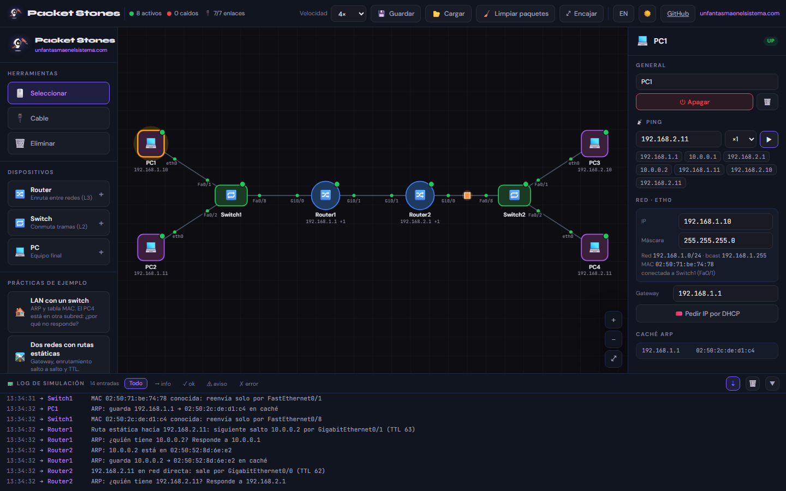

<p align="center">
  <a href="https://www.unfantasmaenelsistema.com"></a>
</p>

<h1 align="center">Packet Stones</h1>

<p align="center">
  <b>Simulador de redes educativo en el navegador</b><br>
  Construye una red con routers, switches y PC, lanza un ping y sigue cada paquete: ARP, tablas MAC, enrutamiento, TTL, RIP y DHCP.
</p>

<p align="center">
  <a href="https://unfantasmaenelsistema.github.io/PacketStones/"><b>▶ Abrir la aplicación</b></a> ·
  <a href="https://www.unfantasmaenelsistema.com">unfantasmaenelsistema.com</a> ·
  <a href="LICENSE">Licencia MIT</a>
</p>



Funciona entero en el navegador: no hay servidor, no se instala nada y no se envía ningún dato. La topología se guarda solo en tu navegador y se puede descargar o cargar como JSON.

## Qué se puede hacer

- **Montar la red**: añade routers, switches y PC (clic o arrastrar), conéctalos con la herramienta *Cable* y muévelos por el lienzo. Zoom con la rueda o pellizcando, desplazamiento arrastrando el fondo.
- **Configurar**: IP y máscara por interfaz (con validación), gateway de los PC, `shutdown` de interfaces, rutas estáticas, RIP y servidor DHCP por interfaz del router.
- **Simular tráfico**: ping ×1, ×4 o ×10 desde un PC o un router. El paquete se anima cable a cable y el log cuenta lo que hace cada equipo justo cuando le llega.
- **Provocar fallos**: apaga equipos, baja enlaces, sube la latencia o la pérdida de un cable y observa qué cambia.
- **Interfaz** en español e inglés, tema oscuro y claro, y diseño adaptado a móvil y tablet.

## Qué simula el motor

| Mecanismo | Comportamiento |
|---|---|
| **ARP** | Antes de enviar a una IP de su red, el equipo pregunta por broadcast; el dueño responde y ambos la guardan en su caché ARP. El segundo ping ya no pregunta. |
| **Switch (L2)** | Aprende la MAC de origen en el puerto de entrada. Si conoce la MAC de destino reenvía solo por ese puerto; si no, inunda. Los broadcast se inundan por todos los puertos menos el de entrada. |
| **PC** | Si el destino está en su subred envía directo; si no, al gateway (que debe estar en su red). Un PC no reenvía paquetes ajenos. |
| **Router (L3)** | *Longest prefix match* sobre redes conectadas, rutas estáticas y RIP. Decrementa el TTL en cada salto y descarta con *TTL exceeded* o *destino inalcanzable*. |
| **Redes conectadas** | Solo aparecen si la interfaz tiene IP válida, no está en `shutdown` y el cable y el otro extremo están activos, como en IOS. |
| **RIP** | Vector-distancia con horizonte dividido y métrica máxima 15. Reconverge al instante cuando cae un enlace o un router, y el log dice qué rutas cambian. |
| **DHCP** | Secuencia DORA completa (Discover, Offer, Request, Ack). El router entrega la primera IP libre de su red (desde .100 en redes grandes) y su propia IP como gateway. |
| **ICMP** | Echo request y echo reply por el camino que decidan las tablas (puede volver por otro), con RTT según la latencia de los cables y estadísticas al final. |
| **Pérdida** | Cada cable puede perder un porcentaje de tramas; el paquete se ve caer a mitad del cable. |

## Prácticas incluidas

1. **LAN con un switch**: ARP y tabla MAC. El PC4 está en otra subred: ¿por qué no responde?
2. **Dos redes con rutas estáticas**: gateway, enrutamiento salto a salto y TTL. Prueba a borrar la ruta de vuelta de Router2.
3. **Tres routers con RIP**: baja el enlace Router1–Router3 y mira cómo el tráfico pasa por Router2 (el TTL baja de 62 a 61).
4. **DHCP**: los PC no tienen IP; pídela desde el panel del PC.

## Atajos

`V` seleccionar · `C` cable · `X` eliminar · `Supr` borra lo seleccionado · `Esc` cancela · rueda o pellizco = zoom

## Desarrollo

Requiere Node.js 18 o superior.

```bash
cd frontend
npm install
npm run dev      # http://localhost:3000
npm test         # pruebas del motor de red
npm run build    # genera frontend/dist
```

Cada cambio en `main` se publica solo en GitHub Pages con [este workflow](.github/workflows/pages.yml), que antes pasa las pruebas del motor.

### Estructura

```
frontend/src/
├── engine/
│   ├── NetworkEngine.ts        # simulación: ARP, switches, routers, ICMP, DHCP
│   ├── store.ts                # estado (Zustand), reproducción temporal y autoguardado
│   ├── factory.ts              # equipos, prácticas de ejemplo y validación de JSON
│   └── algorithms/
│       ├── NetworkUtils.ts     # IP, máscaras, subredes y MAC
│       ├── RoutingEngine.ts    # longest prefix match, redes conectadas y RIP
│       └── Topology.ts         # enlaces utilizables y dominios de capa 2
├── components/                 # lienzo, paneles, log y barra superior
├── i18n.ts                     # textos en español e inglés
└── styles.css                  # temas oscuro y claro
frontend/scripts/engine.test.ts # pruebas del motor (npm test)
```

El motor es síncrono: calcula de una vez todo lo que pasa (tramas, tablas y mensajes con su instante) y el store lo reproduce después a la velocidad elegida. Así el resultado es determinista y fácil de probar.

### Limitaciones conocidas

- Solo IPv4. Sin VLAN, STP, OSPF ni NAT.
- Los bucles de switches no generan tormenta de broadcast: el simulador corta la inundación la segunda vez que pasa por el mismo switch.
- Las cachés ARP y las tablas MAC se vacían al cambiar el cableado o el direccionamiento (no caducan por tiempo).

---

Proyecto de [Un fantasma en el sistema](https://www.unfantasmaenelsistema.com) · Licencia [MIT](LICENSE)

<details>
<summary><b>English</b></summary>

**Packet Stones** is an educational network simulator that runs entirely in the browser ([open it](https://unfantasmaenelsistema.github.io/PacketStones/)). Build a network with routers, switches and PCs, send a ping and follow every packet: ARP, MAC learning, longest-prefix routing with TTL, static routes, RIP with instant reconvergence, DHCP (DORA) and per-cable latency and loss. It ships with four guided labs, a step-by-step log, Spanish and English UI, dark and light themes, and works on phones and tablets. Nothing is sent anywhere: your topology stays in your browser and can be exported as JSON. MIT licensed.

</details>
